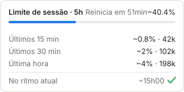
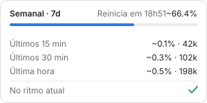

<div align="center">


# limits-left

**Quanto ainda resta dos seus limites do Claude Code, sempre à vista no rodapé do prompt.**

Um mod para o [Claude Code](https://claude.com/claude-code) que mostra o que sobra das janelas de 5 horas e de 7 dias,
acompanha o seu ritmo de consumo e avisa antes de você ficar sem cota.

</div>

---

## O que ele faz

- **Mostra o que resta, não o que foi gasto.** No rodapé do prompt, ao lado do seletor de modelo: `🕐 61%` para a janela de 5 horas e `📅 34%` para a semanal.
- **Guarda o histórico de consumo.** Uma amostra por minuto de cada janela, compartilhada entre todas as suas sessões e mantida entre reinícios.
- **Calcula o seu ritmo.** Quanto você usou nos últimos 15 minutos, 30 minutos e na última hora, em pontos da janela e em tokens, e se nesse ritmo a cota acaba antes do reset.
- **Estima a casa decimal.** As leituras chegam em pontos inteiros; o mod conta os tokens dos seus turnos para estimar onde você está dentro do ponto atual (`~66.4%`).
- **Avisa quando o ritmo está alto demais.** Um `🛑` aparece ao lado da janela em risco, e o Claude em pânico aparece junto dos cartões. Na leitura em que a janela passa do ritmo, um aviso diz qual foi e em quanto tempo ela esgota: notificação do sistema no terminal, toast no app desktop.

<div align="center">


&nbsp;


</div>

## Instalação

### Pelo marketplace

Num terminal com o Claude Code aberto:

```
/plugin install limits-left --marketplace imgidedin/claude-mod-limits-left
```

Responda `y` para adicionar o marketplace e escolha o escopo de usuário. O mod passa a valer na hora, e em toda sessão iniciada depois, incluindo as do app desktop.

> O comando `/plugin` só existe no terminal. No app desktop, instale pelo terminal uma vez ou use o modo manual abaixo.

### Manual

```bash
git clone https://github.com/imgidedin/claude-mod-limits-left.git ~/.claude/mods/limits-left
```

Depois aponte o Claude Code para a pasta em `~/.claude/settings.json`:

```json
{
  "env": {
    "CLAUDE_CODE_PLUGIN_DIRS": "~/.claude/mods/limits-left"
  }
}
```

Se a variável já existir, acrescente a pasta em vez de substituir. O separador é `:` no macOS e no Linux e `;` no Windows. Abra uma sessão nova para carregar. Para atualizar, rode `git pull` na pasta.

### Requisitos

- Claude Code com suporte a mods (function hooks). Testado na versão 2.1.293.
- Um plano por assinatura. Sem os limites de 5 horas e de 7 dias na conta, o mod não tem o que mostrar e fica invisível.

## Como usar

| Onde | O que aparece |
| --- | --- |
| Rodapé do prompt | `🕐 61%` e `📅 34%`: o que resta das janelas de 5 horas e de 7 dias. |
| Clique em qualquer um dos dois | Abre os cartões das duas janelas acima do prompt. Clique de novo para fechar. |
| `/limits` | Abre e fecha os mesmos cartões pelo teclado. |

No terminal, o rodapé é uma linha de texto (`◷ 61% · ▦ 34%`) e os cartões abrem com `/limits`.

### O que cada cartão mostra

- **Cabeçalho:** a janela, quanto falta para reiniciar e o percentual já usado, com a barra de progresso. Um `~` na frente marca uma estimativa.
- **Últimos 15 min, 30 min e última hora:** quantos pontos percentuais da janela foram consumidos em cada período e quantos tokens os seus turnos gastaram nele (`~0.4% · 42k`). Um traço (`–`) significa que o histórico ainda não cobre aquele período, e `<1%` que houve tokens mas a leitura ainda não virou um ponto.
- **No ritmo atual:** um ✓ verde se a cota aguenta até o reset, ou `esgota em ~2h00` em vermelho se não aguenta.

### Quando o aviso aparece

| Janela | Condição |
| --- | --- |
| 5 horas | No ritmo atual, a cota acaba **mais de 30 minutos antes** do reset. |
| 7 dias | O ritmo atual passa de **15 pontos por dia** *e* a cota acaba antes do reset. |

O limite de 15 pontos por dia existe para sobrar cota até o fim da semana: uma semana dividida igualmente dá cerca de 14 pontos por dia.

<div align="center">



<sub>A janela de 5 horas acima do ritmo: o 🛑 no rodapé, o Claude em pânico ao lado dos cartões e a estimativa em vermelho.</sub>

</div>

## Como funciona

A cada resposta do modelo, o Claude Code informa quanto de cada janela já foi usado. O mod registra essa leitura com a hora, mantém a última hora de histórico da janela de 5 horas e o último dia da semanal, e calcula tudo a partir daí.

- **Ritmo:** o consumo da última hora na janela de 5 horas e das últimas 24 horas na semanal, ou do histórico que existir. Quando o mod já sabe quantos tokens cabem em um ponto, o ritmo vem da contagem de tokens, que anda a cada turno; antes disso, vem das leituras.
- **Mínimo para prever:** 30 minutos de histórico. Um único ponto virando em menos de uma hora também não basta, porque diz quando o ponto virou e não a que velocidade a janela anda. Até lá o cartão mostra `coletando dados`.
- **Intervalos sem leitura:** se o Claude Code ficou fechado, o consumo do intervalo é distribuído por interpolação entre as leituras de antes e de depois.
- **Reset da janela:** quando o percentual usado cai, o histórico daquela janela recomeça do zero.
- **Onde fica guardado:** no armazenamento do próprio mod, dentro da pasta de configuração do Claude Code. Nada sai da sua máquina; o mod não faz nenhuma chamada de rede.

### A estimativa entre dois pontos

As leituras chegam em pontos inteiros, então sozinhas elas não dizem quanto você gastou enquanto o número não vira. Para preencher esse intervalo, o mod soma os tokens de cada turno, incluindo os de subagentes, numa contagem compartilhada entre as sessões.

- **Calibração:** cada vez que a leitura de uma janela sobe um ponto, o mod mede quantos tokens couberam naquele ponto. A estimativa só aparece depois de ele presenciar um ponto inteiro, do começo ao fim.
- **Peso dos tokens:** para o percentual, cada tipo de token pesa conforme o preço: saída 5×, escrita de cache 1,25× e leitura de cache 0,1×, em relação à entrada. A diferença de preço entre modelos não entra na conta.
- **Tokens exibidos:** entrada, saída e escrita de cache. A leitura de cache fica de fora, porque cada passo relê a conversa inteira e o número deixaria de dizer algo.
- **Limite do erro:** a estimativa nunca passa de 0,9 dentro do ponto atual e é corrigida a cada virada. Uso fora das sessões com o mod (o chat do claude.ai, outras máquinas) não é contado, e faz o ponto virar antes do previsto.

Na janela de 7 dias o ritmo é medido sobre um dia inteiro, então o aviso semanal leva algumas horas para reagir a um pico de uso. Ele exige também que a cota acabe antes do reset.

## Limitações conhecidas

Mods são uma API em acesso antecipado do Claude Code e podem mudar entre versões. No app desktop, hoje:

- O rodapé do prompt desenha apenas texto e botões. Por isso os ícones são caracteres, e não SVG, e os cartões abrem acima do prompt em vez de flutuar sobre a interface.
- O estilo dos botões do rodapé (altura, borda, padding vertical) é definido pelo app e não acompanha exatamente o seletor de modelo ao lado.
- O ícone do calendário pode aparecer colorido, dependendo da fonte do sistema.

## Desenvolvimento

```bash
claude plugin validate .
```

```bash
claude plugin test .
```

O código fica em [`hooks/register.tsx`](hooks/register.tsx), os testes em [`hooks/register.test.ts`](hooks/register.test.ts) e o contrato de estado em [`types/index.d.ts`](types/index.d.ts). As imagens deste README em `docs/` são geradas pelo próprio mod.

## Licença

[MIT](LICENSE) © 2026 Gidedin
